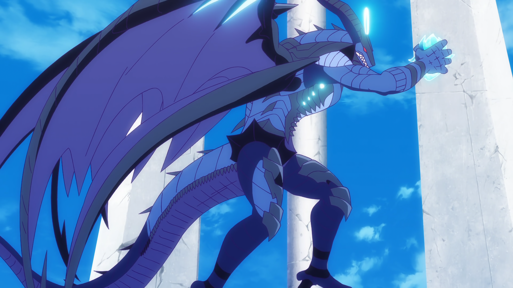

# Senmei

Watch anime in real time, upscaled to 4K, in your browser.

Senmei is an MKV player built from scratch: a hand-written Matroska parser, WebCodecs decoding, and Anime4K's CNN upscaling shaders ported to WGSL and run on WebGPU every frame.

## Quality

The same frame, as decoded (1080p) and after Senmei's Anime4K pipeline (4K). Open each image at full size to compare line work.

**Original, 1080p**


**Senmei + Anime4K, 4K**



## Features

- MKV playback: play/pause, seek, and streaming from a URL over HTTP Range requests
  - video: H.264/AVC (8-bit) and HEVC/H.265 (8/10-bit)
  - audio: AAC stereo
- Real-time upscaling with WebGPU, using a multi-stage, multi-pass render pipeline
- Subtitles with positioning and plain text rendering

## Performance

Measured on 2026-10-11 on an Apple M4 Pro (Helium, WebGPU on Metal), streaming a 1.44 GB MKV over HTTP Range, 1080p → 4K, 819 frames:

- 32.3 ms per 4K frame, so 31 fps max (anime runs at 23.976 fps, a 41.7 ms budget)
- 38 render passes per frame: Clamp Highlights 3, Restore CNN VL 17, Upscale CNN x2 VL 18
- 27.3 ms in the Anime4K passes, about 4.5 ms uploading the frame, 0.46 ms on the CPU

## How it works

- **Matroska parser** ([`mkv.ts`](mkv.ts)): written by hand, with an API tuned for a video player.
- **Decoding:** WebCodecs `VideoDecoder` and `AudioDecoder`.
- **Upscaling:** the WebGPU setup and the Anime4K pipeline are maintained by hand. These Anime4K shaders are ported to WGSL (High-End HQ Mode A preset), in pass order:
  1. `Anime4K_Clamp_Highlights`
  2. `Anime4K_Restore_CNN_VL`
  3. `Anime4K_Upscale_CNN_x2_VL`
  4. `Anime4K_AutoDownscalePre_x2`
  5. `Anime4K_AutoDownscalePre_x4`
  6. `Anime4K_Upscale_CNN_x2_M`

  Which passes run depends on the source and output size, following the GLSL `!WHEN` conditions.
- **Precision:** FP32 shader arithmetic to match GLSL; `rgba16float` intermediates throughout.
- **Color:** the existing sRGB preview canvas is uploaded, so the original and upscaled views share the same video color conversion. Direct hardware `VideoFrame` uploads can take a different browser color path. More on handling color space conversion explicitly: https://x.com/wrennly_dev/status/2039326806260748757
- **Canvas sizing:** the real source frame dimensions and the display box are kept separate. A `ResizeObserver` watches the canvas container, CSS pixels are multiplied by `devicePixelRatio` for the canvas backing size, CSS `aspect-ratio` comes from the current video frame or image dimensions, and sizing reruns on resize, fullscreen and DPR changes.

## Stack

- TypeScript, Vite, [Bun](https://bun.sh/)
- WebGPU, WGSL
- WebCodecs
- [Anime4K](https://github.com/bloc97/Anime4K)

## Local development

```sh
bun install
bun run dev      # http://localhost:3000
bun run build
bun run preview
```

## TODO

- [ ] Map `//!COMPONENTS 1/2` passes to narrower texture formats instead of `rgba16float` everywhere.
- [ ] Play audio through an `AudioWorklet` instead of scheduling one `AudioBufferSourceNode` per decoded chunk: the worklet pulls PCM from a reusable buffer on the audio thread, so there are no per-chunk allocations or seams between chunks, pause/seek don't need to tear down a queue, and the played sample position gives a precise clock to sync video to.
- [ ] Lock-free streaming: one `SharedArrayBuffer` ring buffer between the network and decoder workers (and the audio worklet), synchronized with `Atomics`, so nothing is allocated after startup and the GC never runs.
- [ ] Seek bar previews generated client-side: a second, hidden `VideoDecoder` fetches (via HTTP Range) and decodes only the keyframe for the hovered timestamp, then scales it down with `createImageBitmap`.
- [ ] Adaptive chunk size: measure every fetch, track bandwidth with an exponentially weighted moving average, fetch small chunks just in time on fast connections and buffer more aggressively on slow ones.
- [ ] Judder-free 23.976 fps on 60/144 Hz displays: schedule each frame for a specific vsync using the audio worklet's sample clock and `VideoFrame.timestamp`, instead of drawing whenever a frame is ready.
